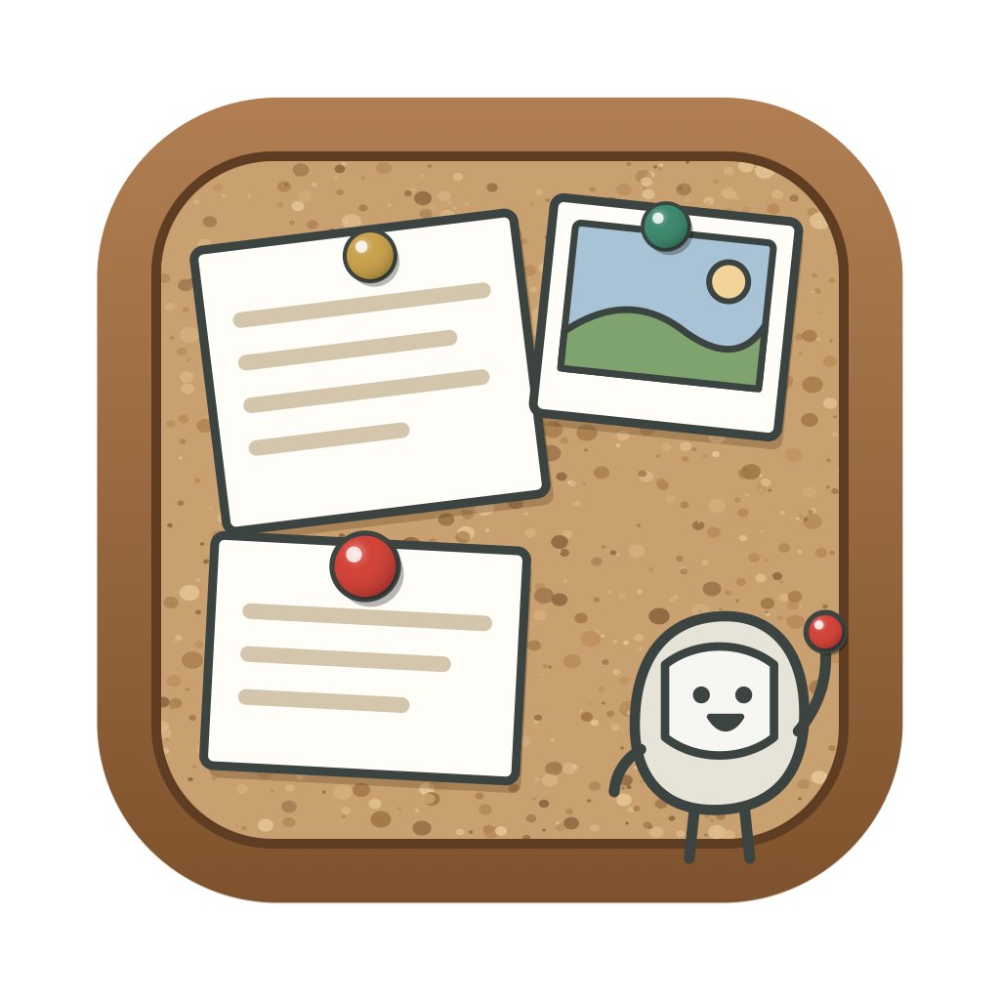
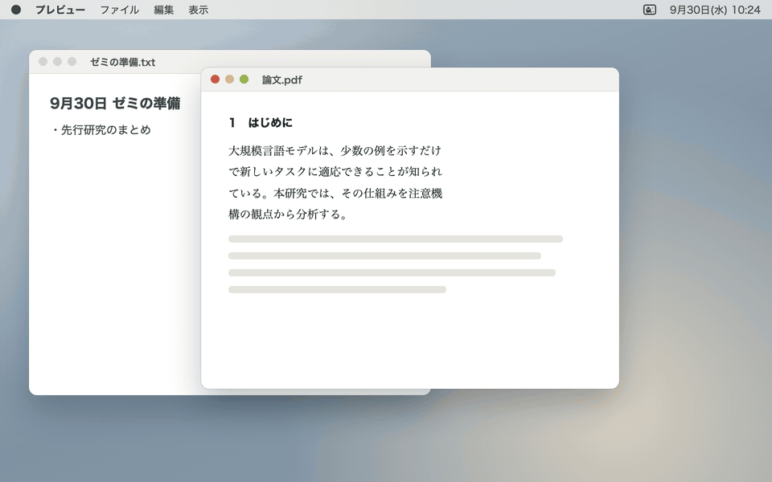

# CorkClip

[English](README.md) | 日本語



CorkClip は、コピーした物をコルクボードにピンで留めるように取っておける、macOS 用のクリップボード履歴アプリです。

`⌘C` でコピーした文字・画像・表・ファイル・パワポの図形などを、元の形のまま覚えておきます。`⌥⌘V` で画面の端からボードを呼び出し、選んで `Enter` を押すだけで貼れます。貼る前に「改行を消す」「表 → LaTeX」などの貼り方を選んで、貼られる内容を先に確かめられます。

CorkClip は、小さな Mac アプリのシリーズ [kobito-tools](https://github.com/kobito-tools) の1つです。



## できること

| 機能 | 内容 |
|---|---|
| 履歴 | コピーした物を、元の形のまま覚えておく。検索・タグ・種類やアプリで絞り込める |
| 貼り方を選ぶ | 「改行を消す」「書式を除く」「表 → LaTeX」など。貼られる内容を先に確かめられる。詳しくは [貼り方を選ぶ](#貼り方を選ぶ) |
| ほかの変換 | 句読点・半角・箇条書きなどの変換をつなげてかける。組み合わせは保存できる |
| 定型文とピン | よく使う文を残しておく。日付や時刻を差し込める |
| 数式画像 | LaTeX の式を、PowerPoint や Keynote にきれいに貼れる画像にする |
| ペーストスタック | 順にコピーした物を、`⌘V` を押すたびに1つずつ貼る |
| カードに残す | 選んだ項目を、シリーズのアプリで読める「その日のクリップ」のカードに残す |

## 動作環境

- macOS 13 以降（Apple Silicon / Intel）
- アプリの画面は日本語だけです。

## インストール

CorkClip は、ソースコードからこの Mac でビルドして入れます。ビルドは `setup.sh` が行います。

### 必要なもの

| もの | 入れ方 |
|---|---|
| Xcode Command Line Tools | ターミナルで `xcode-select --install` を実行する（管理者のパスワードが要る）。無いときは、`setup.sh` がそう伝えて止まる |

### 手順

1. ソースコードを、次のどちらかで手に入れます。
   - ターミナルで次を実行する。

     ```bash
     git clone https://github.com/kobito-tools/CorkClip.git
     ```

   - または、GitHub のこのページで **Code → Download ZIP** をクリックし、ダウンロードした zip をダブルクリックして展開する。
2. ターミナルで、手に入れたフォルダに移り、`setup.sh` を実行します。

   ```bash
   cd CorkClip
   ```

   ```bash
   ./setup.sh
   ```

   ZIP で手に入れたときは、フォルダの名前が `CorkClip-main` のようになります。`cd ` （後ろに空白）と打ってから、Finder のフォルダをターミナルへドラッグしても移れます。
3. `setup.sh` が `CorkClip.app` を作り、Applications フォルダの `kobito-tools` フォルダ（`/Applications/kobito-tools/`）へ移すかを尋ねます。移さないと答えたときは、`CorkClip.app` はソースのフォルダに残ります。
4. 最後に `setup.sh` が示すとおりに、CorkClip を起動します。Dock には出ず、メニューバーにコルクボードのアイコンが出ます。自分で開いたときは設定画面が開くので、起動したことが分かります。ログイン時の自動起動と、`corkclip://` のリンクから起動したときは開きません。

あとで新しくするときは、新しいソースコードで、もう一度 `./setup.sh` を実行します。履歴と設定はそのまま残ります。

| 手に入れ方 | 新しくするには |
|---|---|
| `git clone` | 同じフォルダで `git pull` を実行してから、`./setup.sh` を実行する |
| Download ZIP | 先に、前のソースのフォルダをゴミ箱に入れる。それから新しい ZIP をダウンロードして展開し、新しいフォルダで `./setup.sh` を実行する。前のフォルダが残っていると、`setup.sh` はそう伝えて止まる |

`setup.sh` について、もう少し：

- `./setup.sh --dry-run` で、何をするかだけを確かめられます。`./setup.sh --yes` は、尋ねずに既定の答えを選びます。何度動かしても大丈夫です。
- `kobito-tools` フォルダが無ければ、シリーズのアイコンを付けて作ります。同じ名前のアプリがすでにあるときは、置き換えてよいかを尋ねます。
- `/Applications` の直下に前の `CorkClip.app` が残っていても、消しません。使わなければ、自分でゴミ箱に入れてください。
- 最後に、起動情報を書き（[ほかのアプリとのつながり](#ほかのアプリとのつながり)）、ソースのフォルダの場所を `~/Library/Application Support/` の下の `kobito-tools/repos/corkclip` にシンボリックリンクで記します。別の CorkClip のソースのフォルダがすでに記されているときは、ビルドの前に止まり、何も変えません。
- もう一度実行したあとは、アクセシビリティと入力監視の一覧から CorkClip を「－」で外し、もう一度加えてください。ビルドごとに署名が変わるので、前の許可が効かなくなります。

### アクセシビリティを許可する

選んだ項目を前のアプリに貼り込むために、アクセシビリティの許可を使います。

1. 許可するまでは、ボードの上に案内が出ます。案内の「システム設定を開く」をクリックします（初めて貼るときにも求められます）。
2. 「プライバシーとセキュリティ」→「アクセシビリティ」で、CorkClip をオンにします。

許可が無い間は、選んだ項目をクリップボードに戻すだけになります。自分で `⌘V` を押せば貼れます。

### 入力監視を許可する

ペーストスタックを初めて使うときに求められます。`⌘V` が押されたことだけを見て、積んだ次の項目に入れ替えます。ペーストスタックを使わなければ要りません。

どちらの許可も、設定（メニューバーのアイコン →「設定…」）の「一般」の一番上で状態を確かめられます。

## 使い方

コピーすると、自動で履歴に入ります。`⌥⌘V` を押すと、画面の右端からボードが出てきます（設定で左端にも変えられます）。貼り先のアプリのフォーカスはそのままなので、選んで `Enter` を押すだけで貼れます。

### ボードの見方

| 場所 | 内容 |
|---|---|
| 上の帯 | 検索欄、並べ替え、設定 |
| プレビューの紙 | 選んでいる項目の中身と、その下に貼り方の一覧 |
| 履歴のカード | 1件ずつ、画びょうで留めたメモ用紙。選んでいる紙は少し持ち上がる |
| 主なキー | 下の帯。貼るときのキーを、名前付きで大きく出す（行をクリックしても同じことをする） |

- 画びょうの色は、ピン留めした物が赤、定型文が緑、ほかは真鍮色です。
- カードの左の色の帯は、コピー元のアプリごとの色です。設定で種類ごと・タグごとにも変えられます。
- 明るい画面と暗い画面のどちらでも読めます。ボードの縁には小人がしがみついています（設定で隠せます）。

### 主なキー

貼るときのキーは4つです。覚えなくても、ボードの下に出ています。

| キー | 動作 |
|---|---|
| `Enter` | そのまま貼る（ダブルクリックでも）。`⇥` で貼り方を選んだときは、その貼り方で貼る |
| `Shift` + `Enter` | 書式を除いて貼る |
| `Ctrl` + `Enter` | 前回の貼り方で貼る（「そのまま」以外で最後に使った貼り方。ボードの下に名前が出る） |
| `→` | ほかの変換と、この項目にできることを開く（`⌘K` でも） |

ほかの基本のキーです。

| キー | 動作 |
|---|---|
| `⌥⌘V` | ボードを出す（もう一度押すか `esc` で閉じる） |
| `↑` `↓` | 項目を選ぶ。プレビューに中身が大きく出る |
| `⇥` / `⇧⇥` | 貼り方を切り替える |
| 右クリック | この項目にできることのメニュー |
| `⌘/` | キーの一覧 |

### 貼り方を選ぶ

プレビューの下に、選んだ項目に合う貼り方だけが並びます。`⇥` で切り替えると、プレビューに実際に貼られる内容が出ます。ほかの項目に移っても、その項目に同じ貼り方があれば続けて使います（ボードを開き直すと「そのまま」に戻ります）。

| 項目 | 並ぶ貼り方 |
|---|---|
| 文章 | そのまま・改行を消す・「，．」に（「、。」に）・半角英数に・数式画像に・★保存した組み合わせ |
| Excel などの表 | 書式付き・プレーン・表 → LaTeX・表 → Markdown・表 → CSV |
| ファイル | ファイル・パス・~ のパス・基準パスから・ファイル名・file:// |
| 画像 | 画像・画像の文字 |
| 数式 | 数式画像・LaTeX の式 |
| 複数選んだとき | そのまま・プレーン・改行を消す（文字をつないで貼る） |

最後の「ほかの変換…」を選んで `Enter` を押すか、`→` を押すと、全ての変換から選べます。

### → で開く画面：ほかの変換と、できること

`→` を押すと、ボードの上半分に「ほかの変換」、下半分に「この項目にできること」が出ます。`←` か `esc` で戻ります。

**ほかの変換**：`↑` `↓` で選ぶと、右に結果が出ます。`Enter` で、変換してから貼ります。`space` で変換をつなげられます（例：改行を消す → 句読点を「，．」に）。`⌘S` で組み合わせを保存すると、一覧で `⌃1`〜`⌃9` を押すだけで使えます。

- 改行を消す・句読点（`、。` ↔ `，．`）・英数字を半角に・半角カタカナを全角に・余分な空白を消す・大文字／小文字／文の先頭だけ大文字
- 表（Excel などのコピー）を LaTeX の `tabular`・Markdown・CSV に
- 引用（`> `）・箇条書き（`- `・`・`）・番号付き
- 数式画像にする

**この項目にできること**：各行の左の文字を押すだけで実行します（`⇥` で一覧に移り、`Enter` でも）。行の右の `⌘` のショートカットを覚えれば、一覧を開かずにも使えます。

| 文字 | 動作 | ショートカット |
|---|---|---|
| `T` | タグを付ける・外す | `⌘T` |
| `P` | ピン留めする | `⌘P` |
| `E` | 編集してから貼る | `⌘E` |
| `M` | 複数の項目を1つにまとめる（複数選んだとき） | `⌘M` |
| `L` | 数式画像を作る | `⌘L` |
| `K` | ペーストスタックに積む | |
| `S` | カードに残す | `⌘S` |
| `U` | カードから外す（カードに残した項目だけ） | |
| `D` | 履歴から削除 | `⌘⌫` |

### そのほかのキー

| キー | 動作 |
|---|---|
| 文字の入力 | 検索（本文・画像の文字・タグ・ファイル名・コピー元のアプリ名。空白で区切ると全てを含む物） |
| `⌃N` `⌃P` | 選択を移動（`⇧` を押しながらで複数選択。`⌘クリック`・`⇧クリック` も） |
| `⌘1`〜`⌘9` | 上から N 番目を貼る |
| `⌘Enter` | コピーだけ（貼らない） |
| `⌥Enter` | 貼り方を切り替えずに、改行を消して貼る |
| `⌃1`〜`⌃9` | 保存した変換の組み合わせ N で貼る |
| `⌥⌘↑` `⌥⌘↓` | ピンの並べ替え |
| `⌘N` | 新しい定型文 |
| `⌘Y`（検索が空のときは `space` でも） | Quick Look |
| `⌘,` | 設定 |
| `esc` | 戻る／検索を消す／閉じる |
| ドラッグ | ほかのアプリへドロップして取り出す |

### 検索と絞り込み

検索欄では、ふつうの語に加えて、次の書き方で絞り込めます。右上のボタンで並べ替え（最後に使った順・コピーした順・使った回数順・種類ごと・コピー元のアプリごと）も選べます。

| 書き方 | 絞り込み |
|---|---|
| `#論文` | タグ |
| `type:画像`・`type:image`・`type:snippet` | 種類（テキスト・書式付き・画像・ファイル・リンク・色・オブジェクト・数式・定型文） |
| `app:Word` | コピー元のアプリ |
| `is:pinned` | ピン留めした物 |
| `after:2026-09-01`・`before:2026-09-30` | コピーした日 |
| `kept:2026-09-28` | その日にカードに残した物 |
| `id:123` | その項目だけ |

### タグ

`⌘T` で付けます。候補を `↑` `↓` で選んで `Enter`、候補が無ければ `Enter` で新しいタグを作ります。`⌫` で最後のタグを外します。

- 設定の「連携」で基準パス（シリーズのアプリで共有するフォルダ）を選ぶと、タグはシリーズのアプリと共有されます。
- 設定の「取得とタグ」で、コピー元のアプリ（例：TeXShop → `#latex`）や、リンクのドメイン（例：arxiv.org → `#論文`）で自動でタグを付ける規則も作れます。

### 定型文とピン

`⌘P` でピン留めした項目と、`⌘N` で作った定型文は、一覧の上の「ピン・定型文」に並び、期限で消えません。定型文には次の書き方を使えます。

| 書き方 | 貼るときに入る物 |
|---|---|
| `{date}`・`{date:yyyy年M月d日}` | 今日の日付 |
| `{time}` | 今の時刻 |
| `{clipboard}` | 今のクリップボード |
| `{cursor}` | 貼ったあとのカーソルの位置 |

### 数式画像（`⌘L`）

LaTeX の式を書くと、その場でプレビューが出ます。`Enter` で画像にして貼ります（`Shift` + `Enter` で改行）。PDF（拡大しても粗くならない）と PNG・TIFF をまとめて載せるので、PowerPoint や Keynote にはきれいな形で、ほかのアプリには画像で貼れます。

- 文字の大きさ、ディスプレイ／文中、文字色、背景（透明・白・黒）を選べます。よく使う描き方は、プリセット（「暗いスライド用（白文字）」など）にできます。
- 元の式を画像に埋め込むので、履歴の数式を選んで `⌘L` を押すと、式を開き直して直せます。
- 設定の「数式」で、全ての式の前に付けるマクロ（`\newcommand` など）を登録できます。

### ペーストスタック（`⌃⌘C`）

始めてから順にコピーすると、画面の上に「スタック N 件」と出て積まれます。あとは `⌘V` を押すたびに、積んだ順に1つずつ貼られます。ボードで選んで `→` の `K` でも積めます。最後まで貼るか、もう一度 `⌃⌘C` を押すと終わります（設定で、新しい物から順にもできます）。

### カードに残す

- `⌘S` で、選んだ項目を基準パスに残します。その日の分は「9月28日のクリップ」という1枚のカードになり、カードを読めるシリーズのアプリに並びます。
- 設定で「このタグが付いたら自動で残す」こともできます。使わなければ、設定で隠せます。
- 残した項目は、`→` の `U`（カードから外す）で基準パスから消せます。
- 基準パスが Google ドライブなどの同期するフォルダなら、残した物はクラウドにも保存されます。パスワードなどを残さないよう気をつけてください。

### ランチャーや URL から開く

ランチャーには `CorkClip.app` を登録します。次の URL でも操作できます。

| URL | 動作 |
|---|---|
| `corkclip://open` | 履歴を開く（`?tag=論文`・`?query=…` で絞り込んで開く） |
| `corkclip://latex` | 数式画像の画面を開く |
| `corkclip://snippet` | 新しい定型文 |
| `corkclip://stack/toggle`（`start`・`stop`） | ペーストスタックを始める・終える |
| `corkclip://pause`（`?minutes=15`）・`corkclip://resume` | 取得を一時停止・再開 |
| `corkclip://settings` | 設定を開く |

URL はほかのアプリやウェブページからも開けます。そのため、一時停止した取得を URL で再開するときは、本当に再開するかを確かめる画面が出ます。自分で開いたのでなければ「再開しない」を選んでください。

### 保存しない物と、消える期限

| 決まり | 内容 |
|---|---|
| 保存しない | パスワード管理アプリ（1Password、Bitwarden、キーチェーンアクセスなど）からのコピー、「保存しないで」の印（`org.nspasteboard.ConcealedType` など）が付いたコピー、一時停止中のコピー。取得しないアプリは設定で加えられる |
| 30日で消える | テキストも含めてどの種類も、最後に使ってから30日で消える。日数は設定の「保存」で種類ごとに変えられる（0 は無期限） |
| 上限 | 5万件、5GB |
| 消えない | ピン留め、定型文、タグの付いた項目（設定で変えられる） |

- ブラウザの拡張機能やターミナルからコピーしたパスワードは、印が無いと保存されます。期限を既定で30日にしているのは、そのためです。
- 消した項目は、データベースの中でも上書きして消します。履歴を Time Machine のバックアップに含めないことも、設定で選べます。

### 終了する

メニューバーのコルクボードのアイコンをクリックし、「CorkClip を終了」を選びます。

## 困ったときは

### `Enter` を押しても貼られない

アクセシビリティの許可が無いと、選んだ項目をクリップボードに戻すだけになります。「システム設定」→「プライバシーとセキュリティ」→「アクセシビリティ」で、CorkClip がオンになっているか確かめてください。アプリを更新したあとに動かなくなったときは、一覧から CorkClip を「－」で外し、もう一度加えてください。

### ペーストスタックで `⌘V` を押しても、次の項目にならない

「システム設定」→「プライバシーとセキュリティ」→「入力監視」で、CorkClip がオンになっているか確かめてください。

### コピーした物が履歴に入らない

- メニューバーのアイコンから、取得が一時停止になっていないか確かめてください。
- パスワード管理アプリからのコピーや、設定で「取得しないアプリ」に加えたアプリからのコピーは、保存しません。

### `⌥⌘V` を押してもボードが出ない

ほかのアプリが同じショートカットを使っているかもしれません。設定の「一般」で呼び出すキーを変えるか、ランチャーなどから `corkclip://open` で開いてください。

## アンインストール

1. メニューバーのアイコンから CorkClip を終了します。
2. `CorkClip.app` をゴミ箱へ移します。Applications フォルダの `kobito-tools` フォルダの中か、移さなかったときはソースのフォルダの中にあります。ソースのフォルダも消して構いません。
3. 「システム設定」→「プライバシーとセキュリティ」の「アクセシビリティ」と「入力監視」の一覧から CorkClip を選び、「－」で外します。

履歴も消すときは、次のフォルダを消してください。

- `~/Library/Application Support/CorkClip/`

カードに残した物は、基準パスの `.kobito-tools/CorkClip/` にあります。

起動情報（[ほかのアプリとのつながり](#ほかのアプリとのつながり)）も消すときは、次のファイルを消してください。

- `~/Library/Application Support/kobito-tools/apps/corkclip.json`

## プライバシー

| 項目 | 内容 |
|---|---|
| 通信 | 外部と通信しない。数式の描画は同梱の KaTeX で行い、描画のページは同梱のファイルしか読まない。コピーした HTML も、中の画像などを読みに行かずに文字にする |
| 履歴の置き場所 | この Mac の `~/Library/Application Support/CorkClip/` だけ。クラウドの基準パスには置かない |
| 基準パスに書く物 | 共有のタグと、`⌘S` などでカードに残した物だけ |
| 許可の守り | Hardened Runtime を付けているので、ほかのプログラムが CorkClip にコードを読み込ませて、CorkClip に与えた許可（アクセシビリティ・入力監視）を使うことはできない |

## 開発者向け

### ビルドの詳しい方法

入れ方は [インストール](#インストール) を見てください。ビルドの詳しい方法とソースの構成は [docs/DEVELOPMENT.md](docs/DEVELOPMENT.md)、機能の要件は [docs/REQUIREMENTS.md](docs/REQUIREMENTS.md) を見てください。

### ほかのアプリとのつながり

CorkClip は、`docs/kobito-spec/CONTRACTS.md` に決めたデータの形（約束）だけで、ほかのアプリとつながります。

| 約束 | CorkClip での使い方 |
|---|---|
| 共有タグ（約束⓪-2） | 基準パスの `.kobito-tools/Tags/tags.json` を読み書きする |
| カード（約束③） | `⌘S` で残した項目を、その日のクリップのカードとして基準パスの `.kobito-tools/CorkClip/` に書く |
| 起動情報（約束④） | 起動のたびに、起動のしかたと見せ方（名前・📌 のアイコン・ティールの色）を書く。CorkClip は道具なので、ほかのアプリの中には表示されない |

- 起動情報の置き場所：`~/Library/Application Support/kobito-tools/apps/corkclip.json`
- 起動情報からは「履歴を開く」「今日残したクリップを見る」「定型文を作る」「数式画像を作る」「設定を開く」を呼べます。
- 窓を開かずに起動情報だけを書くには、`CorkClip.app/Contents/MacOS/CorkClip --write-launch-info` を実行します。書いて終わります。`--metadata` は、同じ内容をファイルに書かずに表示します。
- リポジトリの直下の `kobito-app.json` は、シリーズのアプリであることを示す目印です。`kobito/` にアイコン（`icon.svg`・`icon-1024.png`）を置いています。`.app` で配るので `"kind": "native"` です（決まりは `docs/kobito-spec/APP_PACKAGE.md`）。

シリーズのアプリからは、次の `kobito://` の URL で開けます。`open -b io.github.kobito-tools.corkclip "kobito://corkclip/…"` のように、アプリを指定して渡します。

| URL | 動作 |
|---|---|
| `kobito://corkclip/day/2026-09-28` | その日に残した項目で履歴を開く（カードから） |
| `kobito://corkclip/open/123` | その項目を選んで履歴を開く |
| `kobito://corkclip/panel` | 履歴を開く |
| `kobito://corkclip/snippet`・`latex`・`settings` | 新しい定型文・数式画像の画面・設定を開く |

### デモの作り直し

README のデモ（英語版 `docs/images/demo.gif`・日本語版 `docs/images/demo.ja.gif`）は、`scripts/demo/demo.html` に描いた合成の画面を `scripts/demo.sh` でコマ撮りして作ります。Google Chrome、Node.js 22 以降、ffmpeg を使います。

### 不具合の報告

不具合の報告や要望は [Issues](../../issues) で受け付けています。

### ライセンス

CorkClip は [MIT License](LICENSE) で公開しています。数式の描画に [KaTeX](https://katex.org/)（MIT License、`Resources/katex/LICENSE`）を同梱しています。

本ソフトウェアは現状のまま提供され、いかなる保証もありません。使用によって生じたいかなる損害についても、作者は責任を負いません。詳しくは [LICENSE](LICENSE) を見てください。
