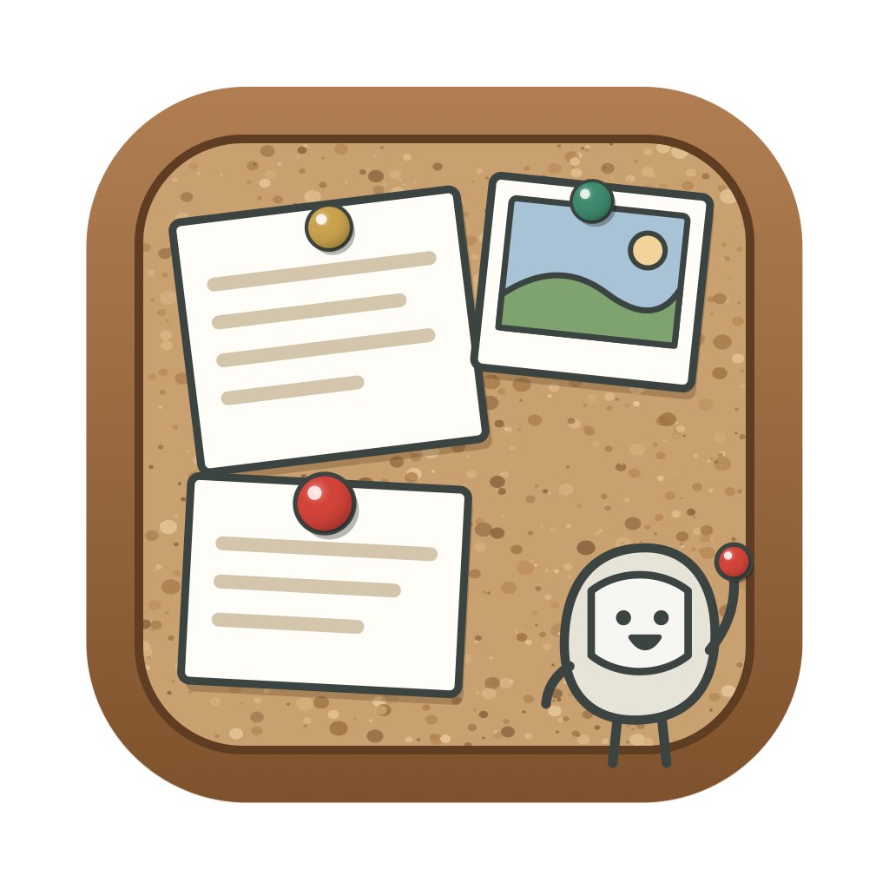
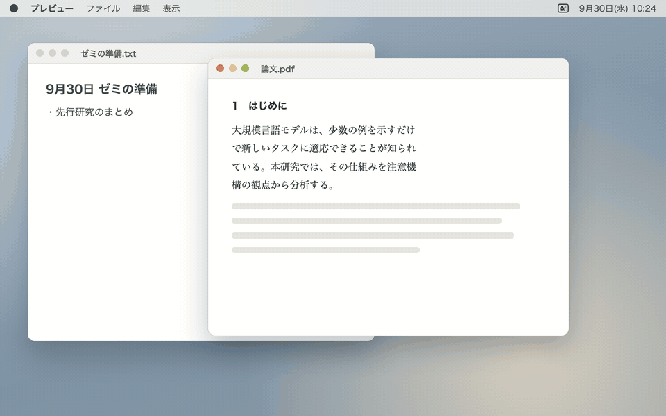

# CorkClip

English | [日本語](README.ja.md)



CorkClip is a clipboard history app for macOS that keeps what you copy like notes pinned to a corkboard.

It remembers the text, images, tables, files, slide shapes and more that you copy with `⌘C`, in their original form. Press `⌥⌘V` to bring up the board from the edge of the screen, pick an item and press `Enter` to paste it. Before pasting, you can choose a paste method such as “remove line breaks” or “table → LaTeX” and see exactly what will be pasted.

CorkClip is part of [kobito-tools](https://github.com/kobito-tools), a series of small Mac apps.



## What it can do

| Feature | What it does |
|---|---|
| History | Keeps what you copy in its original form. Search it, and filter by tag, type or app |
| Paste methods | “Remove line breaks”, “without formatting”, “table → LaTeX” and more. You see the result before pasting. See [Choose a paste method](#choose-a-paste-method) |
| Other transforms | Chain transforms such as punctuation, half-width characters and bullet lists. Save a chain to reuse it |
| Snippets and pins | Keep text you use often. Snippets can insert the date or time |
| Formula images | Turn a LaTeX formula into an image that pastes cleanly into PowerPoint or Keynote |
| Paste stack | Copy several items in a row, then paste them one by one with each `⌘V` |
| Keep as cards | Keep chosen items as a “clips of the day” card that other apps in the series can show |

## Requirements

- macOS 13 or later (Apple Silicon or Intel)
- The app’s screens are in Japanese only. This guide gives the Japanese labels in quotes where you need to find them.

## Install

CorkClip is installed by building it on your Mac from the source code. A script, `setup.sh`, does the build for you.

### What you need

| Item | How to get it |
|---|---|
| Xcode Command Line Tools | Run `xcode-select --install` in Terminal (an administrator password is required). If they are missing, `setup.sh` tells you so and stops |

### Steps

1. Get the source code, in one of these ways:
   - In Terminal, run:

     ```bash
     git clone https://github.com/kobito-tools/CorkClip.git
     ```

   - Or, on this page on GitHub, click **Code → Download ZIP** and double-click the downloaded zip to unpack it.
2. In Terminal, go into the folder you got, and run `setup.sh`:

   ```bash
   cd CorkClip
   ```

   ```bash
   ./setup.sh
   ```

   If you downloaded the ZIP, the folder is named something like `CorkClip-main`. You can type `cd ` (with a space) and drag the folder from Finder into Terminal.
3. `setup.sh` builds `CorkClip.app`, then asks whether to move it into the `kobito-tools` folder in Applications (`/Applications/kobito-tools/`). If you answer no, `CorkClip.app` stays in the source folder.
4. Launch CorkClip as `setup.sh` shows at the end. It does not appear in the Dock. A corkboard icon appears in the menu bar instead.

To update CorkClip later, run `./setup.sh` again with the new source code. Your history and settings are kept.

| If you got it with | To update |
|---|---|
| `git clone` | In the same folder, run `git pull`, then `./setup.sh` |
| Download ZIP | Move the old source folder to the Trash first. Then download and unpack the new ZIP, and run `./setup.sh` in the new folder. If the old folder is still there, `setup.sh` stops and tells you so |

More about `setup.sh`:

- `./setup.sh --dry-run` shows what it would do without changing anything. `./setup.sh --yes` picks the default answers without asking. It is safe to run more than once.
- If the `kobito-tools` folder does not exist, it creates it and gives it the series icon. If `CorkClip.app` is already there, it asks before replacing it.
- An older `CorkClip.app` directly in `/Applications` is left alone. If you no longer use it, move it to the Trash yourself.
- At the end, it writes the launch info (see [Working with other apps](#working-with-other-apps)) and records where the source folder is, as a symbolic link at `kobito-tools/repos/corkclip` under `~/Library/Application Support/`. If another CorkClip source folder is already recorded there, it stops before building and changes nothing.
- After running it again, remove CorkClip from the Accessibility and Input Monitoring lists with **−** and add it again. Each build has a new signature, so the old permission no longer applies.

### Allow Accessibility

CorkClip needs Accessibility permission to paste the chosen item into the app you were using.

1. Until you allow it, a guide is pinned at the top of the board. Click its “システム設定を開く” (Open System Settings) button. You are also asked the first time you paste.
2. In **Privacy & Security → Accessibility**, turn on CorkClip.

Without this permission, CorkClip only puts the chosen item back on the clipboard. You can still paste it yourself with `⌘V`.

### Allow Input Monitoring

You are asked for this the first time you use the paste stack. CorkClip only watches for `⌘V` and swaps in the next stacked item. If you do not use the paste stack, you do not need it.

You can check both permissions at the top of the “一般” (General) tab in the settings (menu bar icon → “設定…”).

## How to use

Everything you copy goes into the history automatically. Press `⌥⌘V` and the board slides in from the right edge of the screen (you can change it to the left edge in the settings). The app you are pasting into keeps its focus, so just pick an item and press `Enter`.

### The board

| Part | What it shows |
|---|---|
| Top strip | Search box, sort order and settings |
| Preview note | The selected item in full, with its paste methods below |
| History cards | One note per item, held by a pushpin. The selected note lifts up a little |
| Main keys | The strip at the bottom shows the paste keys large, with their names. Clicking a row does the same thing |

- Pushpins are red for pinned items, green for snippets, and brass for everything else.
- The color bar on the left of a card shows the app it was copied from. In the settings you can color by type or by tag instead.
- The board works in both light and dark mode. A little kobito clings to its edge (you can hide it in the settings).

### Main keys

There are four keys for pasting. You do not need to remember them: they are shown at the bottom of the board.

| Keys | What happens |
|---|---|
| `Enter` | Pastes as is (double-clicking does too). If you chose a paste method with `⇥`, pastes that way |
| `Shift` + `Enter` | Pastes without formatting |
| `Ctrl` + `Enter` | Pastes with the method you used last (the last one other than “as is”; its name is shown at the bottom of the board) |
| `→` | Opens the other transforms and what you can do with this item (`⌘K` also works) |

Other basic keys:

| Keys | What happens |
|---|---|
| `⌥⌘V` | Shows the board. Press it again or `esc` to close |
| `↑` `↓` | Selects an item. Its content is shown large in the preview |
| `⇥` / `⇧⇥` | Switches the paste method |
| Right-click | Menu of what you can do with the item |
| `⌘/` | List of all keys |

### Choose a paste method

Below the preview, only the paste methods that fit the selected item are shown. Switch with `⇥` and the preview shows exactly what will be pasted. When you move to another item, the same method stays selected if that item has it. Reopening the board goes back to “as is”.

| Item | Paste methods shown |
|---|---|
| Text | As is, remove line breaks, “，．” punctuation (or “、。”), half-width letters and digits, formula image, ★ saved chains |
| Tables from Excel and others | With formatting, plain, table → LaTeX, table → Markdown, table → CSV |
| Files | File, path, `~` path, path from the base folder, file name, `file://` |
| Images | Image, text in the image |
| Formulas | Formula image, LaTeX source |
| Several items selected | As is, plain, remove line breaks (joins the text) |

Choose the last one, “ほかの変換…” (Other transforms), and press `Enter`, or press `→`, to pick from all transforms.

### The → screen: other transforms and actions

Press `→` and the board shows “ほかの変換” (Other transforms) in the upper half and “この項目にできること” (What you can do with this item) in the lower half. Press `←` or `esc` to go back.

**Other transforms:** pick one with `↑` `↓` and the result is shown on the right. `Enter` transforms and pastes. Press `space` to chain transforms, for example “remove line breaks” → “，．” punctuation. Save a chain with `⌘S`, and you can then use it from the list with just `⌃1` to `⌃9`.

- Remove line breaks, punctuation (`、。` ↔ `，．`), half-width letters and digits, full-width katakana, remove extra spaces, upper case, lower case, sentence case
- Tables (copied from Excel and others) to LaTeX `tabular`, Markdown or CSV
- Quote (`> `), bullet list (`- ` or `・`), numbered list
- Formula image

**What you can do with this item:** press the letter on the left of a row to run it (or move to the list with `⇥` and press `Enter`). Once you know the `⌘` shortcut on the right, you can use it without opening the list.

| Letter | What happens | Shortcut |
|---|---|---|
| `T` | Add or remove tags | `⌘T` |
| `P` | Pin | `⌘P` |
| `E` | Edit, then paste | `⌘E` |
| `M` | Merge several items into one (when several are selected) | `⌘M` |
| `L` | Make a formula image | `⌘L` |
| `K` | Add to the paste stack | |
| `S` | Keep as a card | `⌘S` |
| `U` | Remove from the card (only for items kept as a card) | |
| `D` | Delete from the history | `⌘⌫` |

### Other keys

| Keys | What happens |
|---|---|
| Typing | Searches text, text in images, tags, file names and source app names. Separate words with spaces to find items containing all of them |
| `⌃N` `⌃P` | Moves the selection. Hold `⇧` to select several. `⌘`-click and `⇧`-click also work |
| `⌘1` to `⌘9` | Pastes the Nth item from the top |
| `⌘Enter` | Copies only (does not paste) |
| `⌥Enter` | Pastes with line breaks removed, without switching the paste method |
| `⌃1` to `⌃9` | Pastes with saved transform chain N |
| `⌥⌘↑` `⌥⌘↓` | Reorders pins |
| `⌘N` | New snippet |
| `⌘Y` (or `space` when the search box is empty) | Quick Look |
| `⌘,` | Settings |
| `esc` | Goes back, clears the search, or closes |
| Drag | Drop the item into another app |

### Search and filter

Besides plain words, you can filter in the search box like this. The button at the top right sets the sort order: last used, copied, most used, by type, or by source app.

| Write | Filters by |
|---|---|
| `#paper` | Tag |
| `type:image`, `type:snippet` (Japanese names such as `type:画像` work too) | Type: text, styled text, image, file, link, color, object, formula, snippet |
| `app:Word` | Source app |
| `is:pinned` | Pinned items |
| `after:2026-09-01`, `before:2026-09-30` | Date copied |
| `kept:2026-09-28` | Items kept as a card on that day |
| `id:123` | That item only |

### Tags

Press `⌘T`. Pick a suggestion with `↑` `↓` and press `Enter`. If nothing matches, `Enter` creates a new tag. `⌫` removes the last tag.

- Choose a base folder (a folder shared by the apps in the series) in the “連携” (Connections) tab of the settings, and your tags are shared with the other apps in the series.
- In the “取得とタグ” (Capture and tags) tab, you can make rules that tag items automatically by source app (for example TeXShop → `#latex`) or by link domain (for example arxiv.org → `#paper`).

### Snippets and pins

Items pinned with `⌘P` and snippets made with `⌘N` are listed under “ピン・定型文” (Pins and snippets) at the top of the list. They never expire. Snippets can contain:

| Write | Inserted when pasting |
|---|---|
| `{date}`, `{date:yyyy-MM-dd}` | Today’s date |
| `{time}` | The current time |
| `{clipboard}` | The current clipboard |
| `{cursor}` | Where the cursor ends up after pasting |

### Formula images (`⌘L`)

Type a LaTeX formula and a preview appears right away. `Enter` turns it into an image and pastes it (`Shift` + `Enter` adds a line break). The image is pasted as PDF (stays sharp when enlarged) together with PNG and TIFF, so it pastes cleanly into PowerPoint and Keynote, and as a picture elsewhere.

- Choose the size, display or inline style, text color and background (transparent, white or black). Save the styles you use often as presets, such as “for dark slides (white text)”.
- The source formula is embedded in the image. Select a formula in the history and press `⌘L` to open it again and edit it.
- In the “数式” (Formulas) tab of the settings, you can add macros (such as `\newcommand`) that go before every formula.

### Paste stack (`⌃⌘C`)

Start it and copy items one after another. “スタック N 件” (N items in the stack) appears at the top of the screen. Then each `⌘V` pastes the next item, in the order you copied them. You can also add an item from the board with `→` then `K`. The stack ends when everything is pasted or when you press `⌃⌘C` again. In the settings, you can paste the newest first instead.

### Keep as cards

- `⌘S` keeps the chosen items in the base folder. Each day’s items become one card, such as “9月28日のクリップ” (clips of September 28), which other apps in the series that read cards can show.
- In the settings, you can keep items automatically when they get a certain tag. If you do not use cards, you can hide this feature in the settings.
- To remove a kept item from the base folder, use `→` then `U` (remove from the card).
- If your base folder is synced, for example with Google Drive, kept items are also stored in the cloud. Do not keep passwords or other secrets.

### Open from a launcher or a URL

Register `CorkClip.app` in your launcher. You can also use these URLs:

| URL | What happens |
|---|---|
| `corkclip://open` | Opens the history (`?tag=paper` or `?query=…` opens it filtered) |
| `corkclip://latex` | Opens the formula image screen |
| `corkclip://snippet` | New snippet |
| `corkclip://stack/toggle` (`start`, `stop`) | Starts or ends the paste stack |
| `corkclip://pause` (`?minutes=15`), `corkclip://resume` | Pauses or resumes capturing |
| `corkclip://settings` | Opens the settings |

Other apps and web pages can open these URLs too. So when a URL asks to resume a paused capture, CorkClip asks you to confirm first. If you did not open it yourself, choose “再開しない” (Do not resume).

### What is not saved, and when items expire

| Rule | Details |
|---|---|
| Not saved | Copies from password managers (1Password, Bitwarden, Keychain Access and others), copies marked “do not save” (such as `org.nspasteboard.ConcealedType`), and copies made while paused. You can add more apps to skip in the settings |
| Gone after 30 days | Every type, text included, is deleted 30 days after you last used it. Change the number of days per type in the “保存” (Storage) tab of the settings (0 means never) |
| Limits | 50,000 items and 5 GB |
| Never deleted | Pinned items, snippets and tagged items (you can change this in the settings) |

- Passwords copied from browser extensions or Terminal are saved if they carry no “do not save” mark. That is why items expire after 30 days by default.
- Deleted items are also overwritten inside the database. You can also exclude the history from Time Machine backups in the settings.

### Quit

Click the corkboard icon in the menu bar and choose “CorkClip を終了” (Quit CorkClip).

## Troubleshooting

### Pressing `Enter` does not paste

Without Accessibility permission, CorkClip only puts the chosen item back on the clipboard. Make sure CorkClip is turned on in **System Settings → Privacy & Security → Accessibility**. If it stopped working after an update, select CorkClip in that list, remove it with **−**, and add it again.

### `⌘V` does not move to the next item in the paste stack

Make sure CorkClip is turned on in **System Settings → Privacy & Security → Input Monitoring**.

### Copied items do not appear in the history

- Check the menu bar icon to see whether capturing is paused.
- Copies from password managers, and from apps you added to the skip list in the settings, are not saved.

### Pressing `⌥⌘V` does not show the board

Another app may use the same shortcut. Change the shortcut in the “一般” (General) tab of the settings, or open the board with `corkclip://open` from a launcher.

## Uninstall

1. Quit CorkClip from the menu bar icon.
2. Move `CorkClip.app` to the Trash. It is in the `kobito-tools` folder in Applications, or in the source folder if you did not move it. You can then delete the source folder too.
3. In **System Settings → Privacy & Security**, select CorkClip in the **Accessibility** and **Input Monitoring** lists and remove it with **−**.

To remove the history as well, delete this folder:

- `~/Library/Application Support/CorkClip/`

Items kept as cards are in `.kobito-tools/CorkClip/` in your base folder.

To also remove the launch info file (see [Working with other apps](#working-with-other-apps)), delete this file:

- `~/Library/Application Support/kobito-tools/apps/corkclip.json`

## Privacy

| Topic | Details |
|---|---|
| Network | CorkClip does not use the network. Formulas are drawn with the bundled KaTeX, and the drawing page loads only bundled files. Copied HTML is turned into text without loading the images or other files it points to |
| Where the history lives | Only in `~/Library/Application Support/CorkClip/` on your Mac. It is never put in the base folder, even if that folder is in the cloud |
| What goes in the base folder | Only shared tags and the items you keep as cards with `⌘S` and the like |
| Protecting the permissions | The app is built with the Hardened Runtime, so other programs cannot load code into CorkClip to use the permissions you gave it (Accessibility and Input Monitoring) |

## For developers

### Build details

To install, see [Install](#install). For build details and the source layout, see [docs/DEVELOPMENT.md](docs/DEVELOPMENT.md). For the feature requirements, see [docs/REQUIREMENTS.md](docs/REQUIREMENTS.md). Both are in Japanese.

### Working with other apps

CorkClip connects to other apps only through the data formats (“contracts”) defined in `docs/kobito-spec/CONTRACTS.md`.

| Contract | How CorkClip uses it |
|---|---|
| Shared tags (⓪-2) | Reads and writes `.kobito-tools/Tags/tags.json` in the base folder |
| Cards (③) | Writes the items kept with `⌘S` as a clips-of-the-day card in `.kobito-tools/CorkClip/` in the base folder |
| Launch info (④) | Each time it starts, writes how to launch it and how to show it (name, 📌 icon, teal color). CorkClip is a utility, so it does not show up inside other apps |

- Launch info location: `~/Library/Application Support/kobito-tools/apps/corkclip.json`
- From the launch info, other apps can call “open the history”, “see today’s kept clips”, “make a snippet”, “make a formula image” and “open the settings”.
- To write the launch info without opening a window, run `CorkClip.app/Contents/MacOS/CorkClip --write-launch-info`. It writes the file and exits. `--metadata` prints the same content without writing the file.
- `kobito-app.json` at the repository root marks this as a kobito-tools app. The icons (`icon.svg`, `icon-1024.png`) are in `kobito/`. It is shipped as an app, so its kind is `"native"` (see `docs/kobito-spec/APP_PACKAGE.md`).

Apps in the series can open CorkClip with these `kobito://` URLs. Pass them to the app by its ID, like `open -b io.github.kobito-tools.corkclip "kobito://corkclip/…"`.

| URL | What happens |
|---|---|
| `kobito://corkclip/day/2026-09-28` | Opens the history with the items kept on that day (from a card) |
| `kobito://corkclip/open/123` | Opens the history with that item selected |
| `kobito://corkclip/panel` | Opens the history |
| `kobito://corkclip/snippet`, `latex`, `settings` | New snippet, the formula image screen, the settings |

### Rebuild the demo

The README demo (`docs/images/demo.gif`) is a drawn mock-up of the board in `scripts/demo/demo.html`, captured frame by frame with `scripts/demo.sh`. It needs Google Chrome, Node.js 22 or later, and ffmpeg.

### Issues

Bug reports and requests are welcome in [Issues](../../issues).

### How this was made

CorkClip was developed with the help of ChatGPT (OpenAI) and Claude (Anthropic). This is a personal project and is not affiliated with OpenAI or Anthropic.

### License

CorkClip is released under the [MIT License](LICENSE). It bundles [KaTeX](https://katex.org/) (MIT License, `Resources/katex/LICENSE`) to draw formulas.

The software is provided “as is”, without warranty of any kind. The author is not liable for any damage arising from its use. See [LICENSE](LICENSE) for details.
